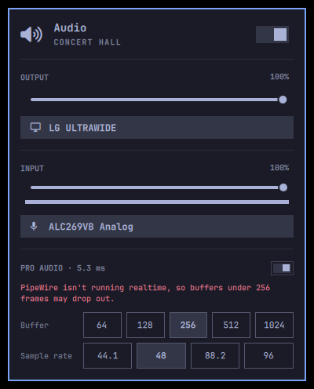
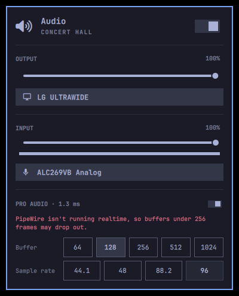
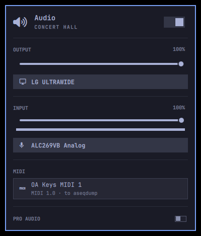
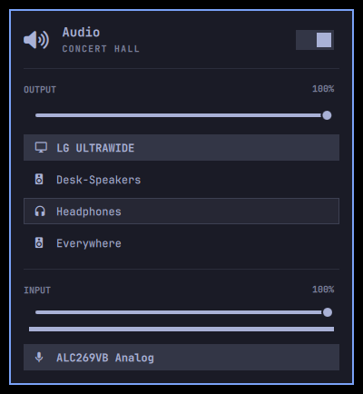

# Omarchy audio

Pro audio pieces for [Omarchy](https://github.com/omacom/omarchy), written as four small branches on its `quattro` branch (`e485c6224`), each ready to go in as its own PR. Proposal and discussion: [omacom/omarchy#13832](https://github.com/omacom/omarchy/discussions/13832).

| Branch | What it adds | Base | PR text |
|---|---|---|---|
| [`audio-pro`](../../compare/quattro...audio-pro) | `omarchy audio pro on/off`: a small PipeWire buffer and a locked sample rate, applied live and restored by a user unit when PipeWire starts, with a toggle in _Trigger > Toggle_ | `quattro` | [prs/1-audio-pro.md](prs/1-audio-pro.md) |
| [`audio-panel-pro`](../../compare/audio-pro...audio-panel-pro) | A PRO AUDIO section in the audio panel: switch, buffer and sample-rate pills, keyboard cursor | `audio-pro` | [prs/2-audio-panel-pro.md](prs/2-audio-panel-pro.md) |
| [`audio-aggregate`](../../compare/quattro...audio-aggregate) | `omarchy audio aggregate`: aggregate and multi-output devices on PipeWire's `combine-stream`, from the command or _Setup > Audio_ | `quattro` | [prs/3-audio-aggregate.md](prs/3-audio-aggregate.md) |
| [`audio-midi`](../../compare/audio-panel-pro...audio-midi) | `omarchy audio midi`: list and connect ALSA sequencer ports, and a MIDI section in the audio panel | `audio-panel-pro` | [prs/4-audio-midi.md](prs/4-audio-midi.md) |

Each PR text says what was tested, what was measured on a running desktop (PipeWire 1.6.8, WirePlumber 0.5.17), and what could not be checked.

## Screenshots

The audio panel, run on a headless layer-shell surface against a real PipeWire.

| Pro audio, 256 frames at 48 kHz | 128 frames at 96 kHz | MIDI port | Multi-output device |
|---|---|---|---|
|  |  |  |  |

The code in the branches is Omarchy's, under its [MIT license](https://github.com/omacom/omarchy/blob/quattro/LICENSE).
